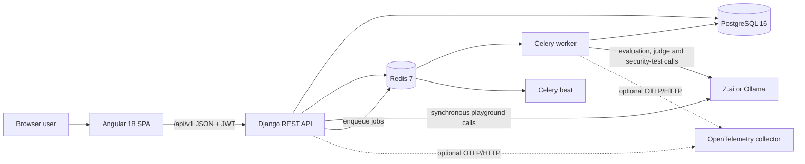
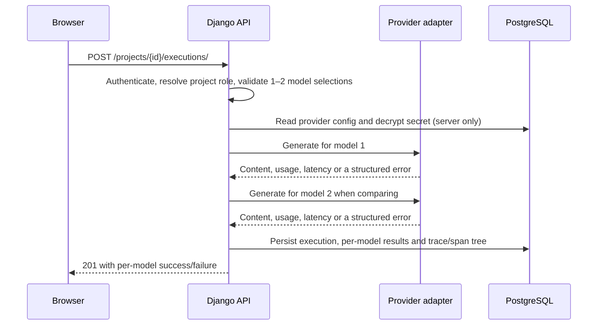
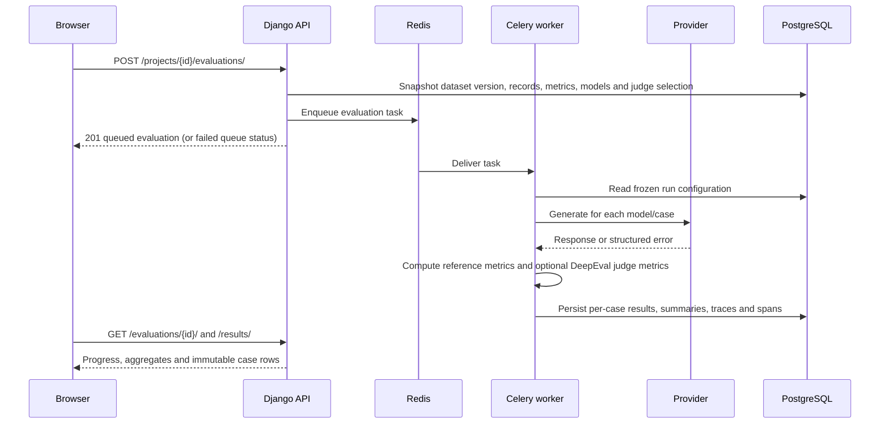

# Architecture

ModelScope AI is a modular Django monolith with an Angular single-page application,
PostgreSQL as the source of truth, Redis/Celery for asynchronous work, and provider
adapters at the model boundary. The architecture follows the specification's mandated
shape rather than introducing microservices, Kubernetes, a vector database, or event
streaming.

## System context



The browser never receives provider API keys. The API decrypts a project provider
secret only on the server, calls the provider through an adapter, and stores the
result. The SPA talks only to the versioned API.

## Runtime components

| Component | Responsibility |
|---|---|
| Angular SPA | Authentication, workspace/project navigation, playground, datasets, evaluations, observability, security, AI security testing and analytics/reporting UI. |
| Django REST API | Validation, tenant authorization, synchronous playground execution, API reads/writes, OpenAPI schema and Swagger UI. |
| Celery worker | Evaluation runs, security scans, AI security test runs and observability maintenance. |
| Celery beat | Daily observability rollup/retention task when rollups are enabled. |
| PostgreSQL | Authoritative store for users, tenancy, projects, provider metadata, prompts, executions, datasets, evaluations, traces, findings, test runs and reports. |
| Redis | Celery broker/result backend and cache. It is not the only store for user-visible results. |
| Provider adapters | Translate the internal request/response contract to Z.ai's OpenAI-compatible API or a local Ollama server. |
| OpenTelemetry | In-process spans are always created when tracing is enabled; OTLP export is optional and requires an endpoint. |

## Backend module layout

```text
backend/
  config/                 Django settings, URLs, WSGI/ASGI, Celery app
  apps/
    accounts/             Custom email user, JWT auth
    workspaces/           Workspace and membership roles, tenant checks
    projects/             Projects and project-scoped collection actions
    providers/            Provider configs, encrypted secrets, model catalogue
    prompts/              Saved prompts and append-only versions
    playground/           Synchronous model execution and execution history
    datasets/             Datasets, record CRUD and validated imports
    evaluations/          Celery-backed evaluation runs and per-case results
    observability/        Traces, spans, rollups, retention and dashboards
    security/             Heuristic scans, findings and AI security test runs
    analytics/            Dashboards, model comparison and report snapshots
  integrations/
    providers/            Adapter interface, Z.ai/Ollama adapters, HTTP client
    evaluation/           Metric registry, reference scorers, DeepEval judge
    telemetry/            OTel tracing, pricing and logging filters
    security/             PII, prompt-injection and unsafe-output detectors
    security_testing/     Fixed attack-case catalogue and result detectors
    reporting/            CSV and dependency-free PDF report rendering
  common/                 Audit events, encryption, health, pagination, errors
  tests/                  pytest API/unit/integration tests
```

## Main request flows

### Playground execution



Playground calls are synchronous. A failure for one model in a comparison is stored on
that result while the other model's result remains successful. Provider failures never
discard the whole execution.

### Evaluation



An evaluation is a snapshot. Editing the dataset later does not rewrite an existing
run. A rerun creates a new evaluation rather than mutating prior results.

### Security scans and AI security testing

Security scans and AI security test runs are separate features:

- **Security scans** (`/security/scans/`) read existing dataset, prompt or execution
  text and run deterministic PII, prompt-injection and unsafe-output detectors. Evidence
  is redacted before storage.
- **AI security testing** (`/security-testing/runs/`) sends a fixed, reviewed catalogue
  of single-turn attack cases to project models and classifies the actual responses as
  pass, fail or inconclusive.

Both run asynchronously through Celery. Neither blocks normal playground execution.
Neither is a guarantee of security; their assumptions and limitations are documented in
[SECURITY.md](SECURITY.md).

### Tracing and retention

Playground, evaluation and judge calls create database traces and span trees. The trace
explorer can resolve the linked execution or evaluation. OTLP export is optional.

The daily observability maintenance task aggregates completed days into `TraceRollup`
rows and, only when `OBSERVABILITY_TRACE_RETENTION_DAYS` is positive, deletes old raw
trace rows after a successful rollup. Rollups are retained. Retention applies to raw
traces, not to playground executions, evaluation results or datasets.

## Tenant and permission model

`Workspace` is the tenant boundary. A `Membership` links a user to a workspace with one
of four roles: owner, admin, member or viewer. Projects, providers, prompts, executions,
datasets, evaluations, traces, security records and reports ultimately belong to a
workspace through a project.

When a caller is not a workspace member, project-scoped resources are reported as `404`
rather than `403` so their existence is not disclosed. A member who lacks a required
role receives `403`. Roles are enforced in service functions and API permissions; the UI
is not the security boundary.

The full role matrix and secret-handling model are in [SECURITY.md](SECURITY.md).

## Data and consistency rules

- Primary keys are UUIDs for domain entities; timestamps are timezone-aware UTC.
- Provider secrets live in a separate one-to-one table, encrypted with Fernet. They are
  never returned by the API, written to traces, or included in project JSON.
- Dataset record changes increment the dataset version. Evaluation results copy the
  input, expected output and context so old runs remain reproducible.
- Prompt versions are append-only; restoring a version creates a new version.
- Every model call records success or a structured error. A judge metric failure is
  stored per metric and does not crash the whole evaluation.
- Cost is reported only when both provider token usage and explicit pricing are known.
  Otherwise it is `unavailable` or `partial`, never silently zero.
- Redis is broker/cache, not the authoritative result store. User-visible results are in
  PostgreSQL.
- Cross-tenant reads are tested to return `404`; unauthenticated API calls return `401`.

## Deployment topology

The supplied Compose stack starts six services: `db`, `redis`, `backend`, `worker`,
`beat` and `frontend`. PostgreSQL and Redis are not published on host ports. The backend
runs migrations before Gunicorn starts. The frontend is an nginx-served Angular build
that proxies `/api/` to the backend. `host.docker.internal` is added so a containerized
backend/worker can reach a local Ollama server on the host. LM Studio is not a supported
adapter yet; see [ADR-0005](adr/ADR-0005-provider-scope.md).

This Compose file is a **development** stack: it uses `config.settings.dev`, plain HTTP,
and the development frontend server config. A production deployment requires production
settings, TLS termination, secure cookies/HSTS, a real secret store and a backup plan.
Those requirements and the current gaps are covered in [OPERATIONS.md](OPERATIONS.md).

## Extension points

- **New provider:** implement `ProviderAdapter`, register a `ProviderConfig.Kind`, add
  serializer validation and endpoint rules, and add adapter tests. Do not bypass the
  endpoint allow-list.
- **New evaluation metric:** add a `MetricDefinition` to the registry and a scorer or
  judge implementation. Expose only metrics that can actually execute.
- **New security check:** add a `CheckDefinition` and detector; update the catalogue so
  the UI and API pick it up automatically.
- **New attack case:** add a reviewed `AttackCase` with explicit pass/fail criteria,
  detector and limitations. Never accept arbitrary attack prompts from clients.
- **New report section:** add the section key and snapshot builder; keep old report
  snapshots valid by versioning the schema.
