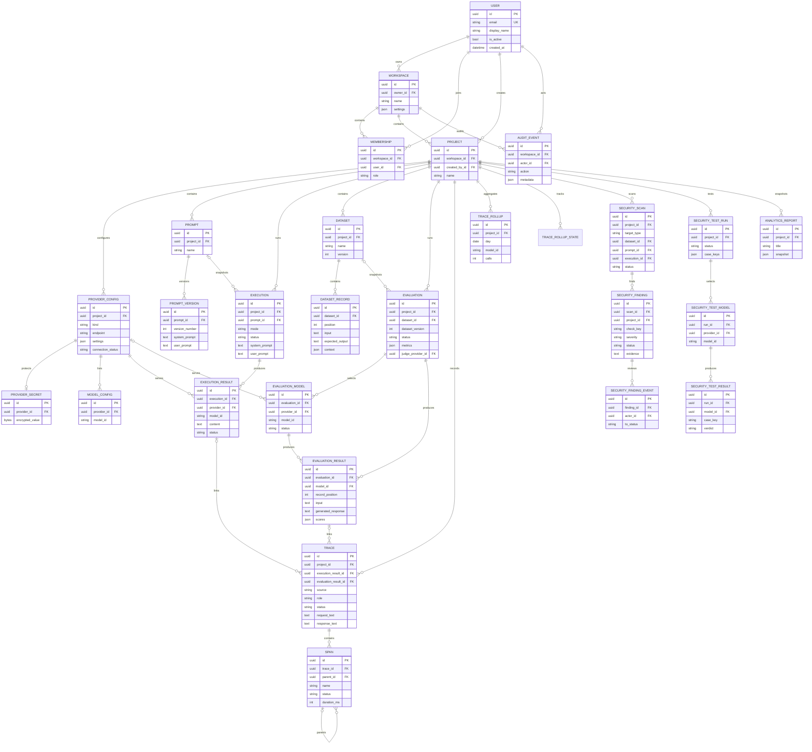

# Data model and migrations

PostgreSQL is the authoritative store. Domain tables use UUID primary keys, timezone-aware
timestamps and foreign keys that generally cascade within a project/workspace. Redis is a
broker/cache and is never the only store for a user-visible result.

## Entity relationship diagram

The diagram is intentionally high level: it shows ownership and the main relationships,
not every column. Field-level definitions live in the Django models and migrations.



## Ownership and invariants

- **Tenant boundary:** workspace membership is the authorization source. Every project
  resource is reachable only through a project whose workspace has a membership for the
  caller. Cross-tenant access returns `404`.
- **Provider secrets:** `ProviderSecret` is a one-to-one row separate from configuration
  JSON. The value is Fernet-encrypted and never serialized to API responses or traces.
- **Provider scope:** provider configs belong to a project, not a workspace. Reusing a
  provider across projects requires creating a new config.
- **Prompt history:** versions are append-only. Updating a prompt creates a new version;
  restoring creates another version rather than rewriting an old row.
- **Execution snapshots:** an execution stores the system/user prompt and parameters it
  used. Re-running an execution creates a new row and keeps the old one immutable.
- **Dataset versions:** creating, editing, deleting or importing records increments
  `Dataset.version`. Evaluation rows record the dataset name/version and copy each
  record's input, expected output and context into `EvaluationResult`.
- **Evaluation immutability:** completed per-case results are not rewritten by a rerun.
  A rerun creates a new `Evaluation`.
- **Trace links:** a trace can point to an execution result or an evaluation result.
  Playground/evaluation request text is resolved from those linked records; judge calls
  also store their own prompt/response up to 4,000 characters.
- **Rollups:** `TraceRollup` is a pre-aggregated daily history used by analytics. The
  `TraceRollupState` row tracks how far each project has been rolled up. Deleting raw
  traces does not delete rollups.
- **Security evidence:** finding evidence is redacted before storage. The original
  sensitive value is not written into `SecurityFinding`.
- **Reports:** `AnalyticsReport.snapshot` is a frozen report document. Reports are not
  recalculated when source data changes.

## Migrations

Migrations are ordinary Django migrations under:

```text
backend/common/migrations/
backend/apps/*/migrations/
```

Apply them with:

```bash
cd backend
python manage.py migrate
```

Check for model/migration drift (the same check CI runs):

```bash
cd backend
python manage.py makemigrations --check --dry-run --settings=config.settings.test
```

The test settings use SQLite for hermetic unit/API tests. That verifies migration
execution and model consistency, but it does **not** prove behavior on PostgreSQL. Run
migrations against PostgreSQL in the Compose stack before accepting a release:

```bash
docker compose -f infrastructure/docker-compose.yml --env-file .env up -d db
docker compose -f infrastructure/docker-compose.yml --env-file .env exec backend \
  python manage.py migrate --settings=config.settings.dev
```

### Migration notes

- Back up PostgreSQL before applying migrations to a database with data you care about.
- The API container runs `manage.py migrate` on startup in the supplied Compose file.
  In a multi-replica deployment, run migrations as a single explicit job before rolling
  out API/worker replicas instead of letting every replica race.
- `ProviderSecret.encrypted_value` requires the same `PROVIDER_SECRET_KEYS` used when it
  was written. Restoring a database without that key leaves secrets undecryptable.
- Dataset version numbers are data, not schema. Do not reset them during a restore.
- Trace retention is a data operation, not a migration. Run
  `python manage.py purge_traces` or let the scheduled maintenance task apply it.
- Do not edit applied migration files. Add a new migration for every model change.

## Backup and restore

The repository does not yet contain an automated backup job. The minimum manual procedure
is:

```bash
# Back up PostgreSQL from the running Compose database. The shell inside the
# container reads its own POSTGRES_USER/POSTGRES_DB values.
docker compose -f infrastructure/docker-compose.yml --env-file .env exec -T db \
  sh -c 'pg_dump -U "$POSTGRES_USER" -d "$POSTGRES_DB" -Fc' > modelscope.dump

# Restore into an empty database.
docker compose -f infrastructure/docker-compose.yml --env-file .env exec -T db \
  sh -c 'pg_restore -U "$POSTGRES_USER" -d "$POSTGRES_DB"' < modelscope.dump
```

Also retain:

- the matching `PROVIDER_SECRET_KEYS` in a secret manager, separate from the database
  backup;
- the deployment `.env`/configuration (not in source control);
- any external provider credentials needed to recreate Z.ai access.

Redis persistence is enabled in Compose (`appendonly yes`), but Redis is not a substitute
for a PostgreSQL backup. Queued Celery jobs can be lost if Redis is lost; re-run the
affected evaluations/scans/tests after recovery.

See [OPERATIONS.md](OPERATIONS.md) for the production backup/restore checklist and
[SECURITY.md](SECURITY.md) for retention and secret-handling rules.
