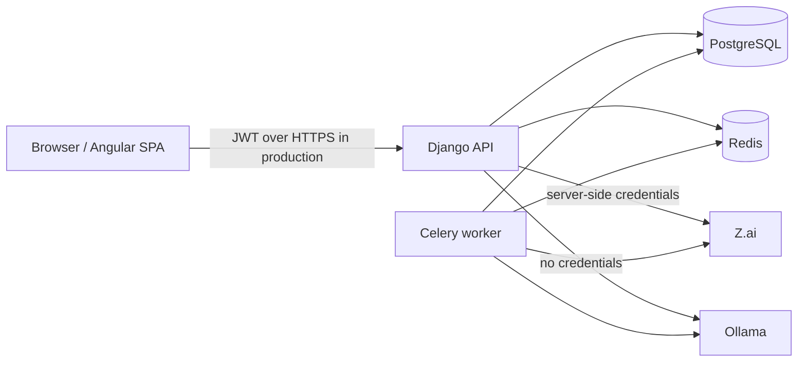

# Security model

This document describes what the application enforces today, what it deliberately does
not claim, and the remaining security/hardening gaps. Security is layered: API
authorization is authoritative, but deployment configuration and operator practice are
also part of the boundary.

## Trust boundaries

- The browser is untrusted. It never receives provider API keys or other server secrets.
- The API and worker are trusted application components.
- PostgreSQL and Redis are trusted infrastructure and must not be exposed publicly.
- Z.ai is an external data processor: prompts/responses sent there leave the deployment.
- Ollama is local but unauthenticated by default; expose it only on a trusted network.
- The frontend is a static SPA. Its route guards are usability controls, not the
  authorization boundary.

## Authentication

- Email/password authentication with a custom user model; email is unique and
  case-insensitive.
- Passwords are hashed with Argon2 (with PBKDF2 fallbacks for verification).
- Django password validators are applied at registration.
- JWT access tokens last 15 minutes by default.
- Refresh tokens last 7 days, rotate on refresh, and old refresh tokens are blacklisted.
- The API default permission class is `IsAuthenticated`; public endpoints opt out
  explicitly (`register`, `login`, `refresh`, health).
- Failed login responses are uniform to avoid account enumeration.

### Current authentication gaps and controls

- Login is throttled by client address + hashed email (`RATE_LIMIT_LOGIN`, default
  10/min), and model-call/evaluation endpoints have separate limits. There is no account
  lockout, CAPTCHA or MFA.
- No email verification or self-service password-reset flow.
- The Angular client stores the access **and refresh** tokens in `localStorage`. Any XSS on
  the origin can read them. CSP is applied by API middleware and the nginx frontend
  config (`script-src 'self'`), which limits script injection but does not eliminate the
  residual risk. HttpOnly, Secure, SameSite cookies with CSRF protection remain the
  stronger design and are tracked as a residual risk.
- JWT signing uses `SECRET_KEY` (HS256). Rotating the Django secret invalidates existing
  tokens. There is no separate JWT signing-key rotation process.

## Authorization and tenant isolation

`Workspace` is the tenant boundary. A user reaches a project only through a membership in
the project's workspace. Cross-tenant resource lookups intentionally return `404` to avoid
disclosing existence; insufficient role inside a known workspace returns `403`.

### Role summary

| Capability | Viewer | Member | Admin | Owner |
|---|---:|---:|---:|---:|
| Read workspace/projects/content | yes | yes | yes | yes |
| Create projects | no | yes | yes | yes |
| Edit/delete own project | no | yes | yes | yes |
| Edit/delete any project | no | no | yes | yes |
| Create/run playground, datasets, evaluations, scans, security tests | no | yes | yes | yes |
| Edit/delete own dataset | no | yes | yes | yes |
| Edit/delete any dataset | no | no | yes | yes |
| Review/resolve security findings | no | yes | yes | yes |
| Create/update/test providers | no | no | yes | yes |
| Add/remove members and change roles | no | no | yes | yes |
| Rename/configure workspace | no | no | yes | yes |
| Delete workspace | no | no | no | yes |

Additional ownership rules:

- Admins cannot remove/demote an owner or promote someone to owner through the member
  endpoints.
- Members can modify only projects/datasets they created; admins and owners can modify any
  in the workspace.
- The workspace owner relationship is protected from deletion; workspace deletion is
  owner-only.
- Provider secrets are write-only and never included in list/detail responses.

The role checks live in services and API permissions, not only in the Angular UI. The
test suite includes cross-tenant IDOR, role-boundary and unauthenticated-access tests.

## Provider secrets

- Provider API keys are stored in a separate `ProviderSecret` row as Fernet ciphertext.
- Fernet provides authenticated encryption (AES-128-CBC + HMAC-SHA256).
- The key comes only from `PROVIDER_SECRET_KEYS`, never from the database or source code.
- The first key encrypts new secrets; all configured keys can decrypt.
- Secrets are never returned by the API, written to traces, included in audit metadata, or
  placed in project JSON.
- Provider connection errors are sanitized before they reach the user.
- Provider endpoints are restricted to prevent the application from becoming an SSRF
  proxy: Z.ai uses a fixed base URL; Ollama endpoints must resolve to localhost,
  `host.docker.internal`, or a loopback IP, use port 11434, and use no credentials, query
  or fragment.
- Dataset imports accept files, not URLs; AI security testing accepts only fixed cases and
  project-owned providers, not arbitrary targets.

### Rotation

1. Generate a new Fernet key.
2. Prepend it to `PROVIDER_SECRET_KEYS`; restart API/worker.
3. Re-enter/update each provider key so it is re-encrypted with the new current key.
4. Verify connections.
5. Remove the old key only after every secret has been migrated.

There is no automatic bulk re-encryption command. A database restore without the matching
key makes provider secrets undecryptable. Store encryption keys in a secret manager,
separate from database backups.

## Privacy and retention

### What is stored

- Account profile and membership data.
- Projects, prompts, datasets and their test inputs/expected outputs/context.
- Playground executions and model responses.
- Evaluation results and metric scores/reasons.
- Traces and spans for model/judge calls, including timing, tokens, errors and optional
  cost estimates. Judge traces store prompt/response text up to 4,000 characters.
- Security findings with **redacted** evidence, review history and scan metadata.
- AI security test attack inputs and actual model responses.
- Analytics/report snapshots.
- Audit events for workspace, membership and provider actions.

### Retention defaults

- Raw observability traces: kept forever by default
  (`OBSERVABILITY_TRACE_RETENTION_DAYS=0`).
- When a positive retention window is configured, complete days are rolled up first; raw
  traces older than the window are then deleted. A failed rollup skips deletion for that
  project so history is not lost.
- Rollups are retained after raw traces are deleted.
- Playground executions, evaluation results, datasets, security findings and AI security
  test results are **not** covered by time-based trace retention. They remain until their
  project/workspace is deleted.
- Workspace admins can export a JSON snapshot from Settings → Security; provider keys,
  password hashes and tokens are excluded. Workspace deletion cascades to projects and
  their records. There is no single-click per-user/account deletion or portable export of
  only one data subject's rows; operators still need a manual procedure for that.
- Redis persistence is enabled in Compose, but Redis is not an authoritative store for
  results.

### Data leaving the deployment

- Prompts, datasets, execution text and AI security test cases are sent to the configured
  provider when a user runs a model call.
- Z.ai is a third-party processor. The operator is responsible for contractual/privacy
  review and for not sending data the provider is not authorized to process.
- Ollama is local but may be on a shared host/network. It has no built-in authentication.
- OTLP export is opt-in. When enabled, trace metadata is sent to the configured collector.
  Request/response text may be present in traces for judge calls; configure the collector
  and retention accordingly.
- DeepEval telemetry is opted out in code, but judge prompts still go to the selected
  judge provider.

## Security scanning and AI security testing

These features are **detection aids**, not guarantees.

### Heuristic scans

- PII patterns cover email, phone, US SSN, payment-card numbers passing Luhn, and IPv4/IPv6.
- Prompt-injection and unsafe-output rules are phrase/pattern based.
- Findings store a redacted evidence excerpt, not the original sensitive value.
- A clean scan does not prove a resource is safe.
- A finding defaults to `potential risk`; `confirmed_vulnerability` is a human review
  decision.
- Scans read stored records asynchronously and do not block playground execution. The
  optional blocking disposition is a review label, not an inline enforcement gate.

### AI security tests

- Only fixed, reviewed single-turn cases are accepted; clients cannot submit arbitrary
  attack prompts or external targets.
- Models must belong to the project's configured `ModelConfig` rows.
- Results distinguish pass, fail and inconclusive. A provider error is inconclusive, never
  a fabricated vulnerability.
- A pass does not prove safety; an inconclusive result is not a pass.
- Model/provider updates and parameter changes can alter results. Rerun the same cases
  before and after changes.
- The test can send synthetic canaries/PII-like strings to the provider. Do not point it at
  a provider that is not authorized to receive those test strings.

## Input limits and abuse controls

- JSON request bodies: Django's `DATA_UPLOAD_MAX_MEMORY_SIZE` and
  `FILE_UPLOAD_MAX_MEMORY_SIZE` are 2 MB.
- Dataset imports: 500 records, 20,000 chars per input/expected output, 60,000 chars of
  context, 4 KB metadata.
- Provider settings: allow-listed inference keys, maximum 16 entries / 4 KB.
- Security scans: `SECURITY_MAX_SCAN_ITEMS` (default 10,000).
- AI security tests: `SECURITY_TEST_MAX_MODELS` (default 5) and
  `SECURITY_TEST_MAX_RESULTS` (default 120).
- Executions: 1–2 models; evaluations: 1–5 models and 6 metrics.

These caps limit accidental cost/abuse. Application-level throttles cover login,
playground execution/rerun, provider test/model listing, evaluation creation/rerun and
security test creation. The provider transport additionally caps concurrent calls per
worker process and retries transient failures with a bounded budget. A reverse-proxy/WAF
is still recommended as defence in depth.

## Transport and browser hardening

Base settings enable:

- `SECURE_CONTENT_TYPE_NOSNIFF`
- `SECURE_REFERRER_POLICY = "same-origin"`
- `X_FRAME_OPTIONS = "DENY"`
- explicit CORS allow-list, credentials disabled
- a CSP (`default-src 'self'`, no third-party scripts, `frame-ancestors 'none'`),
  Permissions-Policy, COOP and nosniff headers via middleware and nginx

Production settings (`config.settings.prod`) add:

- `SECURE_SSL_REDIRECT=true` by default
- secure session/CSRF cookies
- HSTS for one year, including subdomains and preload

The development Compose stack uses **development settings over HTTP**. The production
profile uses `config.settings.prod`; it still expects TLS termination at a trusted reverse
proxy. Before production:

- terminate TLS at a trusted reverse proxy/load balancer;
- serve only HTTPS and set secure proxy headers;
- restrict `/admin/` and protect it with network policy/MFA;
- keep PostgreSQL and Redis off public networks;
- keep the CSP/nginx headers in place and review any new third-party script origin;
- add a WAF and centralized logs as defence in depth.

## Logging and audit

- Logs use a console handler with a trace-id filter. Provider exceptions are sanitized
  before reaching user-visible errors.
- There is no dedicated secret-redaction filter for arbitrary application log messages.
  Do not log request bodies, provider keys or raw credentials.
- Audit events exist for workspace creation/update/deletion, membership changes and
  provider create/update/delete/test/model-list operations.
- Audit views exist in Settings for the account and workspace (admin/owner only), and
  login/logout/password changes/workspace export are recorded. Audit events are database
  rows in `common_audit_event`; retain/export them according to policy.

## Known security gapsTracked in [HANDOVER.md](HANDOVER.md):

- no MFA, email verification or self-service password reset;
- JWTs (including refresh tokens) remain in `localStorage`; CSP reduces but does not
  remove XSS impact;
- no production TLS/host target was supplied, so live deployment hardening is unverified;
- no time-based retention for non-trace records; workspace export/delete is available;
- no per-data-subject export/deletion workflow;
- generic OpenAI-compatible and Hugging Face providers are not implemented;
- heuristic scanners and fixed AI attack cases have expected false positives/negatives.

Report security issues privately to the repository owner; do not open a public issue with
secrets, customer data or an exploitable proof of concept.
